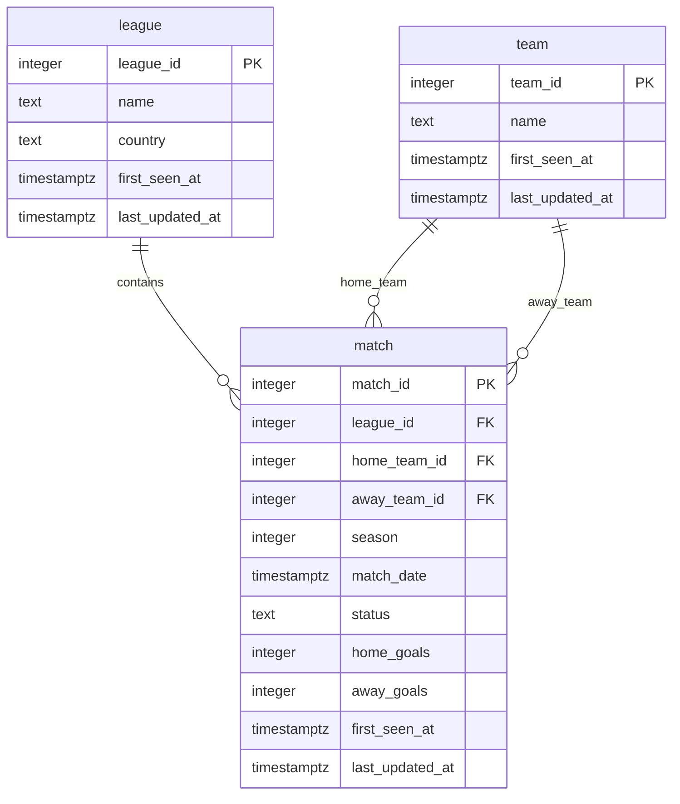

# Football database design

This design uses the API-Football league, team, and fixture IDs in our saved JSON. The latest checked download contains 760 unique Premier League matches across the 2023 and 2024 seasons. IDs from football-data.org are separate and are not treated as API-Football IDs.

## Entity-relationship diagram

## What each row means

- **`league`:** One row represents one league, such as the Premier League. It stores the source ID, name, country, and audit timestamps.
- **`team`:** One row represents one team, such as Arsenal. Its details are stored once even when it appears in many matches.
- **`match`:** One row represents one football game. It records the league, both teams, season, kickoff time, status, scores, and audit timestamps.

## How the tables connect

- One league can contain many matches; each match belongs to exactly one league.
- One team can appear as the home team in many matches; each match has exactly one home team.
- One team can appear as the away team in many matches; each match has exactly one away team.
- Both team references point to the same `team` table. They do not require separate home-team and away-team tables.

## Column types and rules

- Source IDs are integer primary keys. A primary key already requires a value and enforces uniqueness, preventing duplicate entities.
- Names and country use `text`. League and team names, and league country, are required (`NOT NULL`).
- Each match requires its league ID, home and away team IDs, season, date, and status (`NOT NULL`). Foreign keys require the referenced league and teams to exist.
- Season and goals use `integer`. Match date uses `timestamptz` to preserve the instant in time across time zones.
- A `CHECK` constraint requires the home and away team IDs to differ.
- Goal counts may be missing (`NULL`), but a `CHECK` constraint rejects negative values. Missing goals must not be converted to zero.
- Every table requires `first_seen_at` and `last_updated_at`, both using `timestamptz` and initially defaulting to the insertion time. Future update logic must explicitly maintain `last_updated_at`; a default alone does not update it when a row changes.
- In Milestone 2, repeated inserts will skip existing IDs, preserving their audit timestamps. Proper updates will be added in Milestone 3.

## Design decisions

We considered a separate participant table, but chose `home_team_id` and `away_team_id` directly in `match` because a football fixture has exactly one team in each role. This keeps the design easy to understand while supporting comparisons of home and away performance.

The AI initially suggested plural table names (`leagues`, `teams`, and `matches`). The student requested `league`; the design uses singular names consistently as `league`, `team`, and `match`.

## Implementation status

`db/schema.sql` contains the table creation instructions. The student ran them in Supabase and confirmed that all three tables appear in the Table Editor. The student selected Supabase's option to enable Row Level Security; that dashboard setting is not included in the current SQL file.

`ingest/load.py` reads the latest complete local football download, validates the records, and inserts leagues and teams before matches using parameterized queries. Existing primary keys are skipped with `ON CONFLICT DO NOTHING`. All inserts run in one transaction, and the script reports before/after row counts and inserted counts for each table.

Local validation (`python ingest/load.py --dry-run`) found 1 league, 23 teams, and 760 unique matches without connecting to the database. Loading into Supabase and verifying a second run are still pending.
