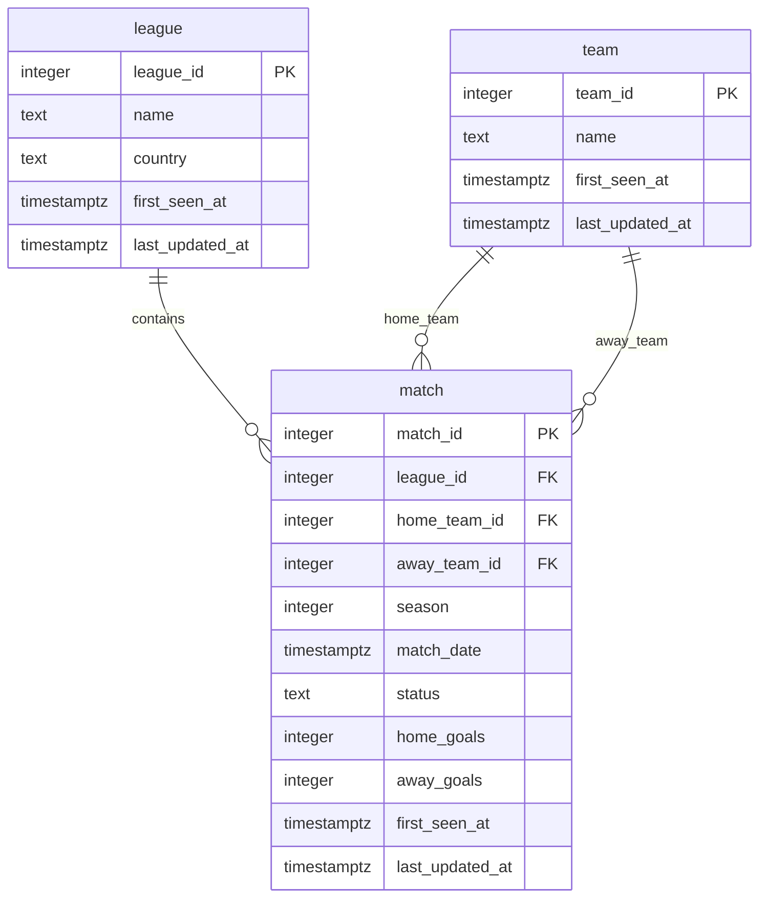

# Football database design

This design uses the API-Football league, team, and fixture IDs in our saved JSON. The latest checked download contains 760 unique Premier League matches across the 2023 and 2024 seasons. IDs from football-data.org are separate and are not treated as API-Football IDs.

## Entity-relationship diagram



## What each row means

- **`league`:** One row represents one league, such as the Premier League. It stores the source ID, name, country, and audit timestamps.
- **`team`:** One row represents one team, such as Arsenal. Its details are stored once even when it appears in many matches.
- **`match`:** One row represents one football game. It records the league, both teams, season, kickoff time, status, scores, and audit timestamps.

## How the tables connect

- One league can contain many matches; each match belongs to exactly one league.
- One team can appear as the home team in many matches; each match has exactly one home team.
- One team can appear as the away team in many matches; each match has exactly one away team.
- Both team references point to the same `team` table. They do not require separate home-team and away-team tables.

## Column types and rules

- Source IDs are integer primary keys. A primary key already requires a value and enforces uniqueness, preventing duplicate entities.
- Names and country use `text`. League and team names, and league country, are required (`NOT NULL`).
- Each match requires its league ID, home and away team IDs, season, date, and status (`NOT NULL`). Foreign keys require the referenced league and teams to exist.
- Season and goals use `integer`. Match date uses `timestamptz` to preserve the instant in time across time zones.
- A `CHECK` constraint requires the home and away team IDs to differ.
- Goal counts may be missing (`NULL`), but a `CHECK` constraint rejects negative values. Missing goals must not be converted to zero.
- Every table requires `first_seen_at` and `last_updated_at`, both using `timestamptz` and initially defaulting to the insertion time. Future update logic must explicitly maintain `last_updated_at`; a default alone does not update it when a row changes.
- In Milestone 2, repeated inserts will skip existing IDs, preserving their audit timestamps. Proper updates will be added in Milestone 3.

## Design decisions

We considered a separate participant table, but chose `home_team_id` and `away_team_id` directly in `match` because a football fixture has exactly one team in each role. This keeps the design easy to understand while supporting comparisons of home and away performance.

The AI initially suggested plural table names (`leagues`, `teams`, and `matches`). The student requested `league`; the design uses singular names consistently as `league`, `team`, and `match`.

## Implementation status

`db/schema.sql` contains the table creation instructions. The student ran them in Supabase and confirmed that all three tables appear in the Table Editor. The student selected Supabase's option to enable Row Level Security; that dashboard setting is not included in the current SQL file.

`ingest/load.py` reads the latest complete local football download, validates the records, and inserts leagues and teams before matches using parameterized queries. Existing primary keys are skipped with `ON CONFLICT DO NOTHING`. All inserts run in one transaction, and the script reports before/after row counts and inserted counts for each table.

Local validation (`python ingest/load.py --dry-run`) found 1 league, 23 teams, and 760 unique matches without connecting to the database. A live check on 2026-11-16 confirmed these counts in Supabase; it did not rerun the loader.

## Access roles

Evidence from the guided setup on 2026-11-16:

- The student created `app_reader` with LOGIN, NOSUPERUSER, NOCREATEDB, NOCREATEROLE, NOREPLICATION, and NOBYPASSRLS, and granted schema USAGE and SELECT on the three data tables.
- The policy screenshot confirms SELECT policies named `app_reader_select`, restricted to `{app_reader}`, with `USING (true)` on all three tables. RLS is enabled.
- The password was set privately; APP_DATABASE_URL is saved in local `.env`. `.env.example` already contains the empty variable name.
- The student's dashboard screenshot confirms Enable Data API is off.
- `db/roles.sql` now records this configuration without a password. Its repeatable form has not been executed as a whole.

The assistant connected using APP_DATABASE_URL and ran `SELECT current_user` and `SELECT count(*)` on each table. Output:

```text
Database user: app_reader
league: 1 readable rows
team: 23 readable rows
match: 760 readable rows
```

The student ran this PowerShell permission check:

```powershell
@'
import os
import psycopg
from dotenv import load_dotenv
load_dotenv(".env")
with psycopg.connect(os.environ["APP_DATABASE_URL"]) as conn:
    print("Connected as:", conn.execute("SELECT current_user").fetchone()[0])
    conn.rollback()
    tests = {
        "DELETE": "DELETE FROM public.team WHERE false",
        "INSERT": "INSERT INTO public.team (team_id, name) SELECT -1, 'permission_test' WHERE false",
    }
    for name, sql in tests.items():
        try:
            conn.execute(sql)
            print(f"FAIL: {name} was allowed")
        except psycopg.errors.InsufficientPrivilege:
            print(f"PASS: {name} blocked — permission denied")
        finally:
            conn.rollback()
'@ | .\.venv\Scripts\python.exe -
```

Student-reported output (the terminal displayed the dash as `?`):

```text
Connected as: app_reader
PASS: DELETE blocked ? permission denied
PASS: INSERT blocked ? permission denied
```

Neither statement affects any rows, and each test rolls back. These tests verify INSERT and DELETE denial on `team`, not an exhaustive privilege audit.

The student also ran the required connection checker from the project folder:

```powershell
.\.venv\Scripts\python.exe scripts/check_db.py --app
```

Student-reported output:

```text
[ok] Connected using APP_DATABASE_URL
     Database user: app_reader
     Server: PostgreSQL 17.11 on aarch64-unknown-linux-gnu
```

Part C adds `sync_runs` through `db/sync_runs.sql`, including a SELECT grant and
RLS policy for app_reader; `db/roles.sql` includes the matching grant. The sync
also maintains `sync_state` with the same read-only access pattern.

### Sync metadata tables

- `sync_state`: one checkpoint per `(league_id, season)`, with the last successful
  run and full-reconciliation times. Data and checkpoints commit together.
- `sync_runs`: UUID run ID, start/end timestamps, constrained success/partial/
  failed status, fetched/inserted/updated counts, sanitized error message,
  manual/schedule trigger, and an `is_dry_run` flag. A NULL finish marks a run
  without recorded completion. Counts cannot be negative. Failed transactions
  report zero committed inserts/updates. Previews retain only a history row.

`scripts/status.py` uses APP_DATABASE_URL and `db/status.sql` to show refresh
freshness and seven-day write counts. See `ingest/README.md` for interruption
and unavailable-database logging limitations.

Live Part C verification on 2026-11-16: the sync created both metadata tables
and applied their SELECT grants and RLS policies. `scripts/status.py` connected
as app_reader and read run `397e43c4-8763-476e-8e96-705bffb3eca7` with success,
760 fetched, 0 inserted, 0 updated, and trigger manual. The seven-day summary
reported one success and zero changes. Full run evidence is in
`docs/sync_tests.md`.
